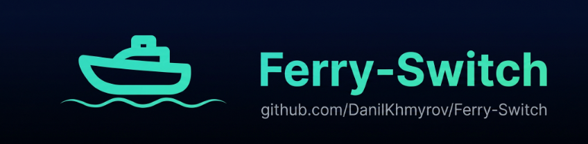
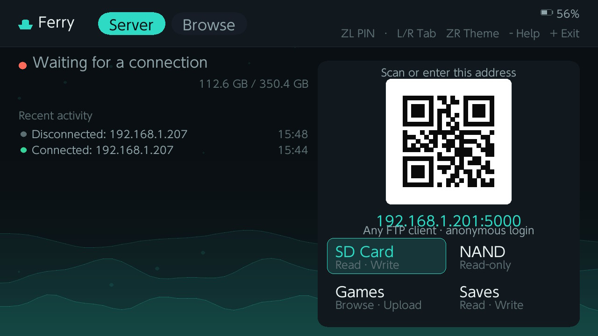
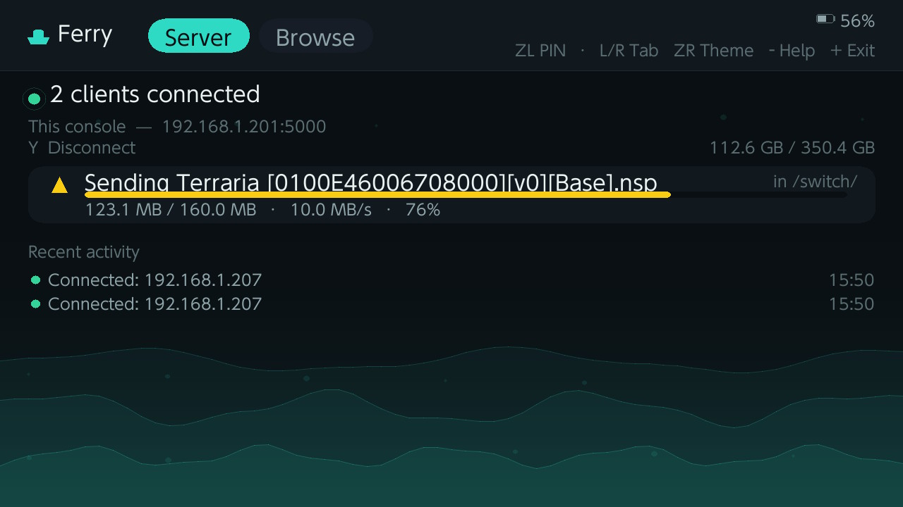
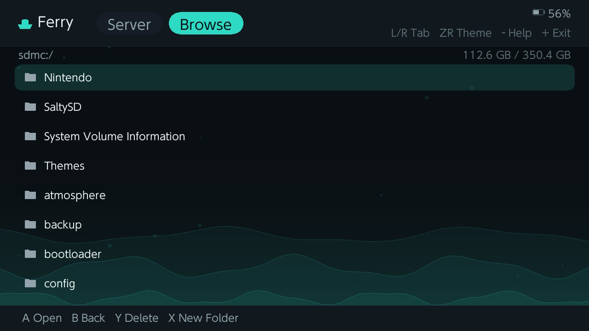

# Ferry (Switch)

*[Русская версия](README.ru.md)*



A native Nintendo Switch homebrew app that turns the console into an FTP server, so files can be moved to and from it over Wi-Fi from any FTP client on the same network. It's a drop-in replacement for DBI's built-in ftpd: same job, plus a live status screen (who's connected, what's being sent or received and how fast), a picker for *which* filesystem to expose, and a local SD card file browser.

Styled to match the [macOS Ferry client](https://github.com/DanilKhmyrov/Ferry) (a dual-pane FTP **and SFTP** client) — same dark palette, same teal accent, same ferry icon — but it's an ordinary FTP server underneath, so any FTP client works.

Built with [devkitPro](https://devkitpro.org/) (devkitA64 + libnx) and SDL2.

## Screenshots







## What Ferry can serve

The Server screen has a 2x2 picker for which filesystem the FTP server exposes as its root. Only one is active at a time, and it can only be changed while nothing is connected.

| Root | What clients see | Access |
| --- | --- | --- |
| **SD Card** | `sdmc:/` — the SD card as-is | Read / write |
| **NAND** | The console's internal `User` partition | Read-only |
| **Installed Games** | One folder per installed title, plus an `Installs` upload folder | Read-only, except `Installs` |
| **Saves** | One folder per installed title; entering one mounts its save data | Read / write inside a save |

### SD Card

The default, and the plain case: the SD card, fully read-write, exactly as any other FTP server would present it.

### NAND

The console's internal storage — the `User` BIS partition — mounted strictly read-only, for looking at and backing up what's there. Nothing under this root can be written, created, renamed or deleted.

### Installed Games

A synthetic listing built from the console's own content-meta database. The top level shows one folder per installed title, named `Game Name [0100ABCD00000000]`, and inside each are that title's installed contents presented as `.nsp` files — one for the base game and one for the update, if an update is installed. For titles that have both, the top level additionally carries a single merged `Game Name[B+U<version>].nsp`.

Those files don't exist anywhere on disk. Ferry builds the PFS0 container header up front from the sizes and content IDs the console reports, then streams the content records straight out of `ncm` as the client downloads them — the same data DBI presents at the same level, assembled on the fly.

The top level also has an **`Installs`** folder. Unlike everything else under this root, it's a real, writable folder on the SD card (`/switch/Ferry/Installs`): upload a `.nsp`, `.nsz`, `.xci` or `.xcz` there — or drop one at the root of this filesystem, which lands in the same place — and it is written to the SD card as a plain file, nothing more.

**Ferry does not install anything.** It does not parse, verify, decrypt or unpack what you upload, and it never writes to the console's system storage. Uploading here only stages a file on the SD card; installing it afterwards is a separate step you perform yourself with DBI or another installer. Ferry is a file-transfer tool, and that is the whole of what this folder does.

### Saves

One folder per installed title. Entering one mounts that title's save data for the console's current user and serves it read-write, so a save can be backed up by downloading it and restored by uploading it back. Writes are committed to the save filesystem after each successful operation, and the mount is released when the client navigates back out or disconnects. The user account is resolved automatically: the preselected user, otherwise the last one opened, otherwise the first account on the console.

### The read-only model

Only the SD card root is writable outright. Everything else is read-only, and that is enforced in a single place — one check in the FTP command dispatcher that every filesystem-modifying command (`STOR`, `MKD`, `RMD`, `DELE`, `RNFR`, `RNTO`) passes through — rather than a guard repeated in each individual handler, because a mistake here risks the console's own data rather than just a bug in the app. It fails closed: anything not explicitly permitted gets `550 Read-only filesystem`.

There are exactly two deliberate exceptions, both narrow:

- a save that this client has actually entered under **Saves** (otherwise restoring a save would be impossible), and
- the `Installs` staging folder under **Installed Games**, which is a plain SD card folder.

## Screens and controls

Ferry launches into the **Server** screen. While nothing is connected it shows the console's address and a QR code for it (scan it instead of typing the address), whether a PIN is required, and the four filesystem cards. Once a client connects, the cards give way to live per-transfer progress — name, direction, percentage, speed — a running activity log, and this session's totals. The header carries battery and SD card free space on both screens.

The **Browse** screen is a local SD card file manager (always the SD card, regardless of which root the FTP server is serving), with per-file-type icons.

Press **-** (Minus) at any time for the in-app help overlay; any button closes it again.

### Server screen

| Control | Action |
| --- | --- |
| **L / R**, or tap a tab | Switch to Browse |
| **D-Pad / Left Stick + A**, or tap a card | Choose which filesystem to serve (only while disconnected) |
| **Y** | Disconnected: cycle SD → NAND → Installed Games → Saves. Connected: disconnect all clients (with confirmation) |

### Browse screen

| Control | Action |
| --- | --- |
| **D-Pad / Left Stick Up/Down**, or tap a row | Move the selection |
| **A**, or double-tap a row | Open the selected folder |
| **B** | Go up one level |
| **Y** | Delete the selection (with confirmation) |
| **X** | Create a new folder (opens the on-screen keyboard) |
| Drag on the list | Scroll |
| **L / R**, or tap a tab | Switch to Server |

### Anywhere

| Control | Action |
| --- | --- |
| **ZL** | Set or clear the PIN clients must send as their FTP password |
| **ZR** | Switch between the light and dark theme |
| **-** | Open or close the help overlay |
| **+** | Exit Ferry |

## Connecting

The server listens on port **5000**. Point any FTP client at `<console-ip>:5000` — the address shown on the Server screen, also encoded in the QR code.

Login is anonymous by default. Press **ZL** to set a PIN; clients then have to send it as their FTP password (on the macOS Ferry client, that's just the connection's password field). A wrong PIN gets the client disconnected immediately. Submitting an empty PIN clears it and returns to open access.

## Protocol support

A minimal FTP server tailored to what the Ferry macOS client actually sends: `USER`, `PASS`, `SYST`, `TYPE`, `ALLO`, `PWD`/`XPWD`, `CWD`/`XCWD`, `CDUP`/`XCUP`, `PASV`, `LIST`/`NLST`, `RETR`, `STOR`, `MKD`/`XMKD`, `RMD`/`XRMD`, `DELE`, `RNFR`, `RNTO`, `SIZE`, `NOOP`, `QUIT`. Passive mode only — clients that insist on active mode (`PORT`) won't work.

Up to 4 clients can be connected, and mid-transfer, at once — which is what makes the Mac app's parallel-transfer mode actually run in parallel against a Switch target. Every socket is non-blocking and each client's current command or transfer advances a bounded step at a time, so one busy client can't stall the others.

The server runs on its own thread, at a priority just below the UI's, so transfers aren't paced by the display refresh and a saturated link can't cost frames. It used to share the frame loop, which capped throughput hard: roughly three quarters of a transfer's wall time went to waiting for the next frame rather than to the network or the SD card.

`ALLO` is advisory here: it doesn't pre-allocate anything, it just lets an upload's on-screen progress show a total and a percentage instead of only bytes-so-far. Clients that don't send it still upload fine.

## Behaviour notes

- The console won't auto-sleep while Ferry is running, so a connection left idle doesn't silently drop.
- Every connect, disconnect, transfer, delete, rename and folder creation is appended to `sdmc:/switch/Ferry/log.txt`, so the history survives an app restart even though the on-screen log only keeps the most recent entries.
- The light/dark choice is saved to `sdmc:/switch/Ferry/config.txt` and restored on the next launch.
- Uploads staged for an installer land in `sdmc:/switch/Ferry/Installs`.

## Known limitations

- The root filesystem can't be switched while a client is connected — switching it out from under an active session would leave that session's working directory pointing at nothing. Disconnect first (**Y** on the Server screen) or wait for the client to disconnect.
- The generated `.nsp` files have been verified structurally, not through an installer. A file pulled off real hardware parses as a valid PFS0 — magic, entry table and string table intact, entries contiguous, the last one ending exactly at the end of the file — and every NCA inside it hashes to its own content ID, which is the same integrity check an installer performs. What hasn't been done is feeding one back to DBI and installing it. A title with an update, the merged `[B+U]` file and multi-gigabyte sizes are also still untested.
- Active-mode FTP is not implemented.

## Building

Requires `DEVKITPRO` set up with `switch-dev`, `switch-sdl2`, `switch-sdl2_ttf`, `switch-sdl2_gfx` and `switch-sdl2_image`:

```bash
export DEVKITPRO=/opt/devkitpro
export PATH=$DEVKITPRO/pacman/bin:$PATH
sudo dkp-pacman -S switch-dev switch-sdl2 switch-sdl2_ttf switch-sdl2_gfx switch-sdl2_image
```

Then, from this directory:

```bash
export DEVKITPRO=/opt/devkitpro
export DEVKITA64=/opt/devkitpro/devkitA64
export PATH=$DEVKITA64/bin:/opt/devkitpro/tools/bin:/opt/devkitpro/portlibs/switch/bin:$PATH
make
```

This produces `Ferry.nro`, with the file-type icons under `romfs/` bundled into it.

## Installing

Copy `Ferry.nro` to `/switch/Ferry/Ferry.nro` on your SD card, then launch it from the Homebrew Menu (hbmenu).

To update it later, upload the new build straight over the existing `Ferry.nro` rather than deleting that file first — an upload replaces the file in place, and the copy you're currently running is the one you'd be trying to delete.

## The macOS client

[Ferry for macOS](https://github.com/DanilKhmyrov/Ferry) is a separate app in its own repository: a dual-pane file client, local filesystem on one side and the remote server on the other, with drag and drop in both directions. It speaks both **FTP and SFTP**, so the same app also works against ordinary SSH/SFTP servers, not just this one.

The two were built to work together — this app is the server, that one is the client — but neither requires the other. Any FTP client can talk to this server, and the Mac client works with any FTP or SFTP server.

## Credits

- QR code rendering: [Nayuki's QR Code generator library](https://www.nayuki.io/page/qr-code-generator-library) (MIT), vendored under `source/vendor/`
- File-type icons: [Material Icon Theme](https://github.com/PKief/vscode-material-icon-theme) (MIT), rasterized into `romfs/icons/`
- Toolchain and libraries: [devkitPro](https://devkitpro.org/) (devkitA64, libnx) and SDL2

## License

GPL-3.0 — see [LICENSE](LICENSE).
